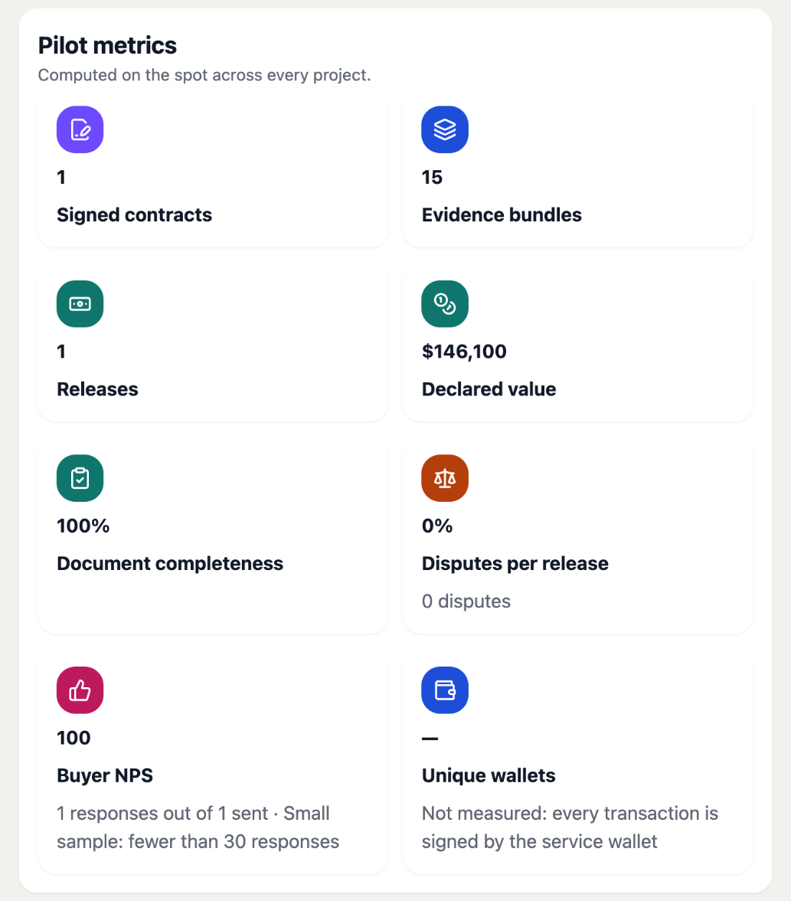
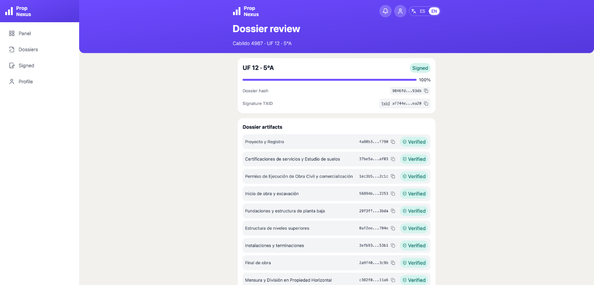

# Pilot Report

This document is the evidence for **Output 1** of Milestone 4: *"Pilot execution with one notary and
two developers; real data; ≥2 releases per pilot; fallback/drill scenarios."* It reports the pilot's
metrics against Criterion 1, its successes and incidents, and the notary's attestation on data
integrity, as Evidence 1 asks. All figures were read from the mainnet deployment on
**October 31, 2026** and checked against the public Cardano mainnet ledger.

> The pilot ran one real project — **Cabildo 4987**, Av. Cabildo 4987, Núñez, Buenos Aires — end to
> end on Cardano mainnet: 10 construction stages certified, 63 real project documents fingerprinted
> and anchored in 15 evidence bundles, one unit sold under a signed contract, the unit's dossier
> signed by the notary, and the full contract amount recorded as released. Every one of its 48
> transactions was verified on a public explorer, and every stored document re-hashes to the
> fingerprint anchored on-chain.

## Scope

| | |
|---|---|
| Project | Cabildo 4987 — 30 functional units, 10 construction stages, status *Delivered* |
| Data | The real documents of the project: plans, permits, certificates, surveys, site photographs |
| Network | Cardano mainnet (`https://propnexus-web-mainnet.onrender.com`) |
| Participants | The developer of the project, a certifier, the notary, the buyer of unit UF 12 · 5°A, and the platform operator — one account each, every one bound to its role and to this project |
| Unit followed end to end | UF 12 · 5°A — 5th floor, 58 m², USD 146,100 |

**Scope decision.** The pilot was run with **one project**, the one already anchored on mainnet, and
its results are reported as they were measured. The targets of Criterion 1 that depend on volume —
several projects, many contracts, many wallets — are therefore not reached, and the table below says
so line by line.

# 1 · Metrics against Criterion 1

| Criterion 1 | Target | Pilot result | |
|---|---|---|---|
| Development pilots onboarded | ≥ 2 | **1** | Not reached |
| Signed contracts | ≥ 10 | **1** | Not reached |
| Evidence bundles hashed | ≥ 20 | **15** | Not reached |
| Releases | ≥ 15 (≥ 2 per pilot) | **1** | Not reached |
| Document completeness | ≥ 95 % | **100 %** | Met |
| Disputes | ≤ 3 % | **0 %** (0 disputes over 1 release) | Met |
| Buyer NPS | ≥ 70 | **100** (1 response out of 1 sent: below the 30-response minimum for a stable score) | Met, on a sample of one |
| Unique wallets across pilots | ≥ 120 | **1** — every transaction is signed by the platform's service wallet | Not reached |
| Value of the developments on the platform | ≥ 800,000 USDM | **USD 3,665,414.93** (the 30 units of Cabildo 4987, priced in US dollars, not USDM) | Met in value, in USD |

How each figure is computed:

- **Document completeness** is the share of each unit's required artifacts that carry an on-chain
  reference. For the dossier of UF 12 · 5°A, 73 of 73 artifacts (10 stages and 63 documents) are
  anchored.
- **Disputes** are counted per release, so the rate exists only once there is a release.
- **NPS** is asked once per buyer, automatically, with their first release; the buyer answered 9.
- **Unique wallets** is not measured in this design: participants do not sign with their own
  wallets; the platform signs every anchor with its service wallet, and attributes each action to
  the identity-bound account that performed it.

# 2 · How the pilot ran

## Timeline (October 31, 2026, UTC)

| Time | What happened |
|---|---|
| 17:54 – 18:06 | Service wallet funded; reference script published on mainnet |
| 18:43 | Project created; its 10 stage threads opened on-chain (10 transactions) |
| 19:07 – 19:32 | 63 documents uploaded and fingerprinted, anchored in 15 evidence bundles |
| 19:07 – 19:30 | Work started on each stage (`Pending → InProgress`) |
| 19:40 – 19:51 | The certifier certified the 10 stages (`InProgress → Completed`) |
| 20:21 | The buyer accepted the invitation to unit UF 12 · 5°A; contract signed |
| 20:22 | The notary signed the unit's dossier |
| 21:33 | The full contract amount recorded as released at stage 10; the buyer answered the NPS survey |

These timestamps record **when each artifact entered the record**, not when the construction work
took place: the project's documents were registered on mainnet in a single session.

## The ten stages

<!-- include: _gen/stages.html -->

## Releases

One release was recorded, for the full contract amount, at stage 10 (*Deed per unit and handover of
the finished property*): USD 146,100.00, anchored in transaction `47a0bb3d…568c2d`. A release is the
record of a payment made **outside** the platform — the platform never holds or moves funds. The
output asks for at least two releases per pilot; the pilot recorded the payment as a single release.

## Fallback and drill scenarios

The fallback scenarios were **not exercised on mainnet** in this pilot: the ten stages of Cabildo
4987 went from `InProgress` to `Completed` without being observed, and no dispute was opened. The
mechanisms are in production and were exercised before:

- **Failed inspection → rework → re-certification** is the `Observed ⇄ InProgress` branch of the
  stage state machine, enforced both by the backend and by the on-chain validator. It was exercised
  on 30 stages during the Milestone 3 volume test on Preprod (180 confirmed transactions).
- **Disputes** between the parties of a stage are recorded by the platform and counted in the
  dispute rate above.

# 3 · Successes

- **Real project, real documents, on mainnet.** A complete construction record — from the project
  registration to the deed and handover — was structured into 10 stages and anchored on Cardano
  mainnet.
- **Independent verification works.** Without relying on the platform's own word:
  - all **48** transaction IDs were found on mainnet through an independent API (Koios);
  - all **15** evidence-bundle Merkle roots were recomputed from the document hashes and match the
    roots on-chain;
  - all **63** stored documents (115.7 MB) were downloaded and hashed again, and every one reproduces
    the fingerprint that was anchored.
- **Certification rules held.** No stage could be completed without its evidence; document
  completeness is 100 %.
- **The professional output is usable.** The notary reviewed and signed the dossier of UF 12 · 5°A
  in the platform, and that signature is itself anchored and verifiable (§5).
- **No server errors.** Sentry shows no issues and Grafana shows no 5xx responses on mainnet
  (Evidence 2, §5).
- **Participants' feedback.** The participants reported that the platform works well, is
  satisfactory, and meets their requirements.

# 4 · Incidents

**There were no incidents during the pilot**: no data was lost or altered, and no anchor failed —
all 48 transactions ended `Confirmed`.

Three defects were found while running the pilot, fixed the same day, and deployed through CI
before the pilot ended. None affected the data:

| Fix | What it was | Data impact |
|---|---|---|
| `c848681` | When several files were anchored together in one bundle, the screens looked the anchor up only for the first file, so the others showed *Pending* (seen in stage 1). The on-chain Merkle root always covered all the files | None — all 15 bundle roots verify against all 63 files |
| `cfc9f97` | Units were listed in text order (UF 1, UF 10, UF 11…) instead of by number | None — display only |
| `fe06df0` | The exported dossier PDF lost accented characters, `°` and `·` | None — export formatting only |

# 5 · Notary attestation on data integrity

The notary attested to the integrity of the pilot's records **in the platform itself**, by signing
the dossier of unit UF 12 · 5°A — and that signature is anchored on mainnet.

| | |
|---|---|
| Dossier | `bitobzet1jkm3hzj39ufqx0j` — unit UF 12 · 5°A, Cabildo 4987 |
| Contents | 10 stages and 63 documents, each with its SHA-256 hash and anchor transaction |
| Master hash (what was signed) | `9846fd9b112416a1fb6cd5b4119e385198006685b659ce799f214016a0f393db` |
| Signed | October 31, 2026, 20:22:11 UTC, by the notary's account |
| Signature transaction | [`af744e52c9ef141e61fd8c6da9609cf6f51f57e026bc06bfe7d778f1b376ea20`](https://cardanoscan.io/transaction/af744e52c9ef141e61fd8c6da9609cf6f51f57e026bc06bfe7d778f1b376ea20) |

**How the attestation was verified.**

1. The master hash was recomputed from the 73 artifacts of the dossier (10 stages and 63 documents,
   with their hashes and transactions): it is exactly `9846fd9b…93db`.
2. The commitment in the signature transaction's metadata was recomputed from the dossier ID, that
   master hash and the signing time: it is exactly the value on-chain,
   `4ed36503…9c8bfb`.
3. The 63 documents behind the dossier re-hash to their recorded fingerprints (§3).

The signature covers the dossier **as it was at 20:22:11 UTC**. The payment release recorded at
21:33 the same day is outside what the notary signed, and has its own transaction.

The Council of Experts format of the Whitepaper also calls for a written sign-off. The notary's
sign-off on data integrity, which lists the same artifacts and states what the attestation does and
does not cover, is submitted alongside this report as
**`M4-Sign-off-Notary-Data-Integrity.pdf`**.

