# Mainnet Deployment

This document is the evidence for **Output 2** of Milestone 4: *"Mainnet deployment with published
mainnet URL & contract addresses; operational dashboards; governance/ops playbooks."* Every value in
it was read from the live mainnet deployment, the mainnet database and the public Cardano mainnet
ledger on **October 31, 2026**, and every transaction was checked against an independent explorer.

| What Milestone 4 asks | Where it is answered |
|---|---|
| Mainnet URL & contract addresses published (Output 2, Criterion 2, Evidence 2) | §1 |
| On-chain events and document hashes (Criterion 2) | §3 |
| Simulated escrow value reported (Criterion 2) | §4 |
| Operational dashboards (Output 2); screenshots of events, wallets, releases (Evidence 2) | §3, §5 |
| Legal greenlight for mainnet from counsel/notary (Criterion 2) | §6 |
| Governance and operations playbooks (Output 2) | §7, §8 |
| List of mainnet TXIDs on a public explorer (Evidence 2) | Annex A, and `mainnet-txids.csv` in the repository |

> Mainnet has been live since October 31, 2026. The pilot project, Cabildo 4987 by Grupo Eagle
> Construcciones S.A., was anchored end to end on mainnet the same day: 48 confirmed transactions, every one of them verified on a public
> explorer, and 0 server errors in the operational dashboards.

## At a glance

| | |
|---|---|
| Web application | https://propnexus-web-mainnet.onrender.com |
| API | https://propnexus-api-mainnet.onrender.com (base path `/api/v1`) |
| Network | Cardano **mainnet** |
| Smart contract | One stage-thread validator, Aiken v1.1.21, **Plutus V3** |
| Code running in production | commit `fe06df0` of https://github.com/Javote/real-world-real-estate (deploy live October 31, 2026, 20:55 UTC) |
| On-chain events of the pilot | **48**, all `Confirmed`, between blocks 14,140,863 and 14,141,386 |
| Document hashes committed on-chain | **63** SHA-256 hashes, in 15 Merkle-rooted evidence bundles |
| Server errors (HTTP 5xx), last 24 h | **0** |

# 1 · Mainnet URL and contract addresses

| Item | Value |
|---|---|
| Web application | https://propnexus-web-mainnet.onrender.com |
| API | https://propnexus-api-mainnet.onrender.com |
| Script hash / minting policy ID | `6207ff3c19443974ee81fbf92419f20b3f45a259ea8808fe4227e6ad` |
| Script address | `addr1w93q0leur9zrja8ws8aljfqe7g9n73dzt84gsz87ggn7dtg3axnw0` |
| Reference script UTxO | `3edf75f533132835612c2d4b03e4268ad20afe0367ffb256a43c2384f3db1ed9#0` |
| Service wallet (signs every platform transaction) | `addr1vytx9747v5eq4xn740r6uy00mk3q9uk855smup9g23hun6qhk5qxw` |
| Admin key hash (the validator's only parameter) | `1662fabe65320a9a7eabc7ae11efdda202f2c7a521be04a8546fc9e8` |
| Compiled blueprint | `contracts/plutus.json` in the repository |

**How these addresses were verified.** None of them is typed by hand in the code: they are derived
from the compiled blueprint. For this document they were derived again from `contracts/plutus.json`
by applying the admin key hash of the mainnet wallet, and the result matched the published values.
The reference script output was checked on the public ledger (Koios): it holds a Plutus V3 script
whose hash is exactly `6207ff3c…e6ad`, and it is unspent.

The validator compiled for mainnet is **the same Aiken code that anchored the 180 Preprod events of
Milestone 3**; only its parameter (the admin key hash) changes between networks, which is why the
mainnet script hash differs from the Preprod one.

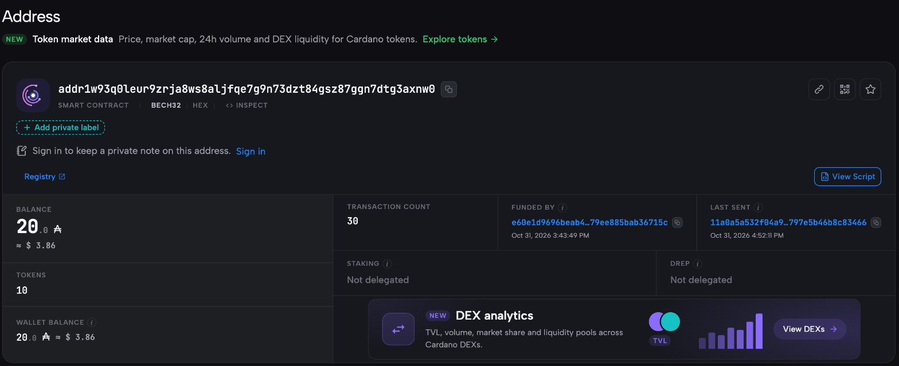

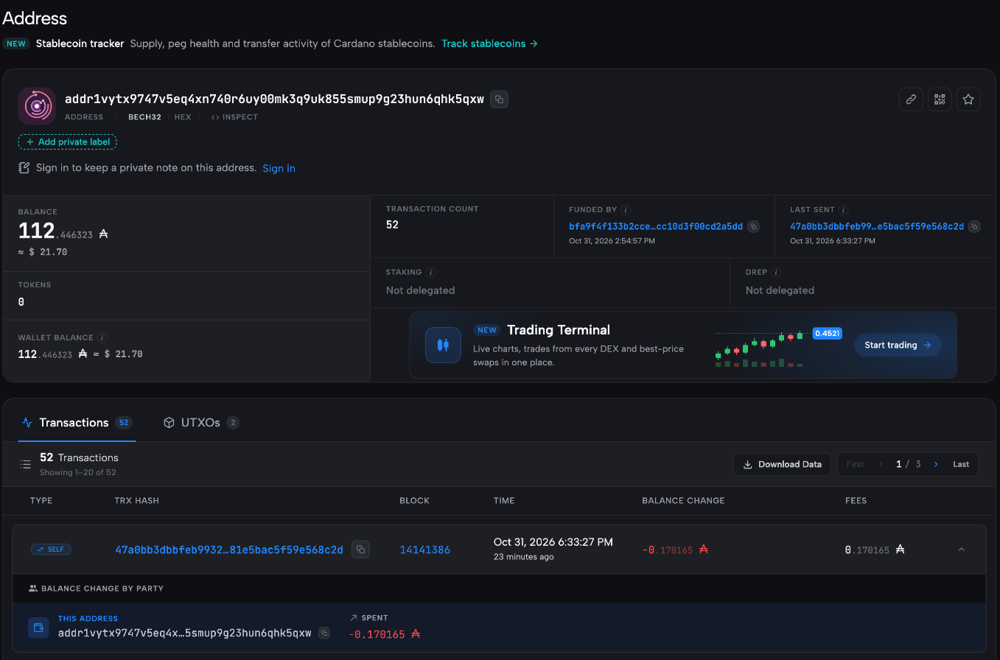

# 2 · What runs on mainnet

The mainnet environment is a separate deployment from Preprod: its own services, database, file
storage, Cardano provider project and wallet. Nothing is shared with the test network except the
observability projects (§5).

| Layer | Mainnet | Notes |
|---|---|---|
| Web | Render static site `propnexus-web-mainnet` | Built with the mainnet API origin and Cardanoscan mainnet as explorer |
| API | Render web service `propnexus-api-mainnet` (Oregon) | `ANCHOR_MODE=real`, `CARDANO_NETWORK=Mainnet` |
| Database | Turso `propnexus-mainnet` (`aws-us-west-2`) | Created empty on October 30, 2026, with delete protection |
| Evidence files | Cloudflare R2 bucket `propnexus-evidencia-mainnet` | Files never leave controlled storage; only their hashes reach the chain |
| Cardano provider | Blockfrost project `real-estate-mainnet` | Mainnet only |
| Blueprint | `render.mainnet.yaml` | Mainnet can only be enabled in the `-mainnet` services; never in local development or CI |

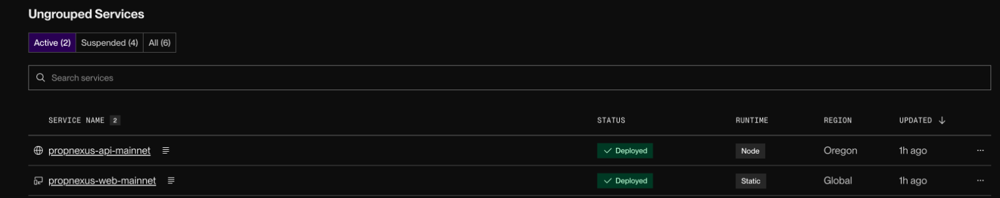

# 3 · On-chain activity

## Events and document hashes

| Criterion 2 | On mainnet |
|---|---|
| On-chain events | **48**, all confirmed |
| Document hashes | **63** |

These are the events of one complete project, Cabildo 4987 (Evidence 1). The same code ran 180
confirmed transactions across 3 projects and 30 stages on Preprod in Milestone 3.

| Event type | Count | What it records |
|---|---|---|
| Stage thread opened | 10 | One on-chain thread per construction stage, each holding its thread token |
| Stage transition | 20 | `Pending → InProgress` and `InProgress → Completed` for each of the 10 stages |
| Evidence bundle anchored | 15 | The Merkle root of a bundle of evidence files, in transaction metadata (label 1904) |
| Buyer invitation accepted | 1 | The buyer joining their unit |
| Dossier signed by notary | 1 | The notary's signature over the unit dossier |
| Payment release recorded | 1 | The record of a payment made outside the platform |
| **Total** | **48** | |

## How each transaction was verified

1. **Existence.** All 48 TXIDs recorded by the platform were looked up on Koios (the community
   Cardano API, independent of the provider the platform uses): **48 of 48 are on mainnet**.
2. **Commitment.** For the 18 transactions that carry metadata, the hash in the metadata equals the
   commitment stored by the platform: **18 of 18**.
3. **Evidence bundles.** Each of the 15 bundle Merkle roots was recomputed from the SHA-256 hashes of
   its files and compared with the root stored and the root on-chain: **15 of 15**, covering all
   **63** document hashes.
4. **Files.** The 63 stored evidence files (115.7 MB) were downloaded from the platform and hashed
   again: **63 of 63** reproduce the hash that was anchored.

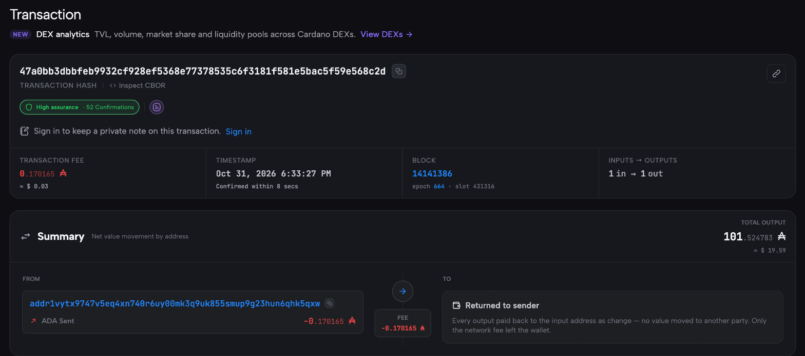

# 4 · Simulated escrow value

The platform **never holds, transfers or releases funds**: no validator custodies value, and the
only ADA locked on-chain is the protocol minimum that accompanies each stage's thread token (2 ADA per
stage, 20 ADA for the pilot), paid by the platform's own service wallet. The escrow is therefore
*simulated*: the platform tracks the amount a buyer's contract commits, and records each payment
made outside the platform, stage by stage, as a hashed and anchored attestation.

| | Amount |
|---|---|
| Value of the contract signed in the pilot (unit UF 12 · 5°A) | **USD 146,100.00** |
| Payments recorded as released (stage 10) | **USD 146,100.00** |
| Simulated escrow value still pending release | **USD 0.00** |
| Value of the 30 units the project holds on the platform | USD 3,665,414.93 |

Amounts are stored as integer cents, never as floating point. The release is anchored in transaction
`47a0bb3d…568c2d` (Annex A, row 48).

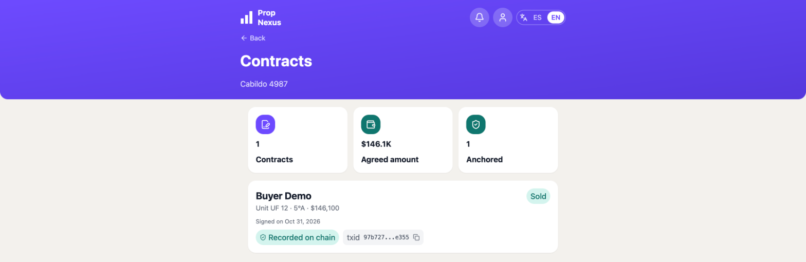

# 5 · Operational dashboards

Five tools watch the mainnet deployment, one question each. Sentry, Grafana and PostHog are the same
projects used for Preprod (their free plans allow one), so the views below are **filtered to the
mainnet hosts**; Render and Blockfrost have mainnet-only projects. The Preprod API has been suspended
since October 31, 2026, so it sends no data.

| Question | Tool | Mainnet view |
|---|---|---|
| What has the pilot produced? | Admin panel of the platform | Pilot metrics, computed on demand |
| How is the server behaving? | Grafana Cloud (OpenTelemetry traces) | Traces filtered to `propnexus-api-mainnet.onrender.com` |
| Did anything fail for anyone? | Sentry | Issues, every project and environment |
| What do people do in the app? | PostHog (web analytics, no personal data) | Filtered to host `propnexus-web-mainnet.onrender.com` |
| Is the infrastructure up? | Render, Blockfrost | Mainnet services and the mainnet provider project |

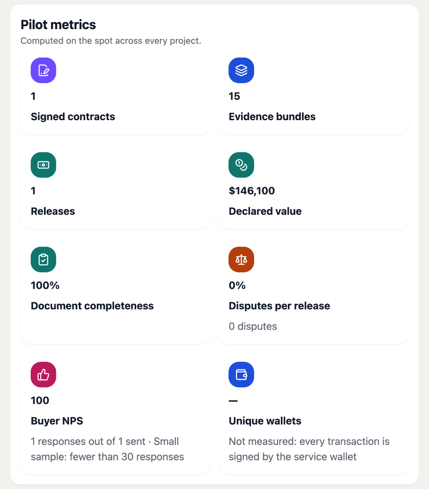

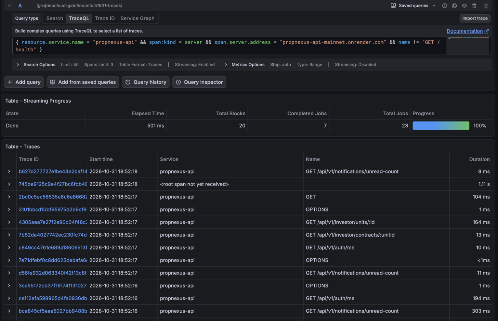

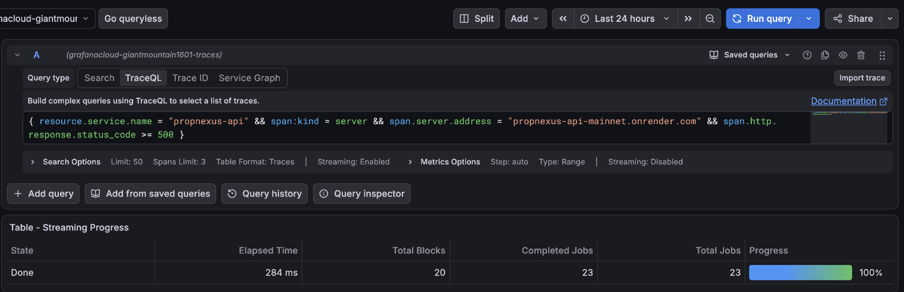

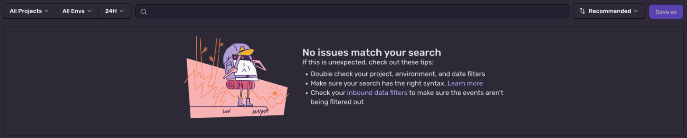

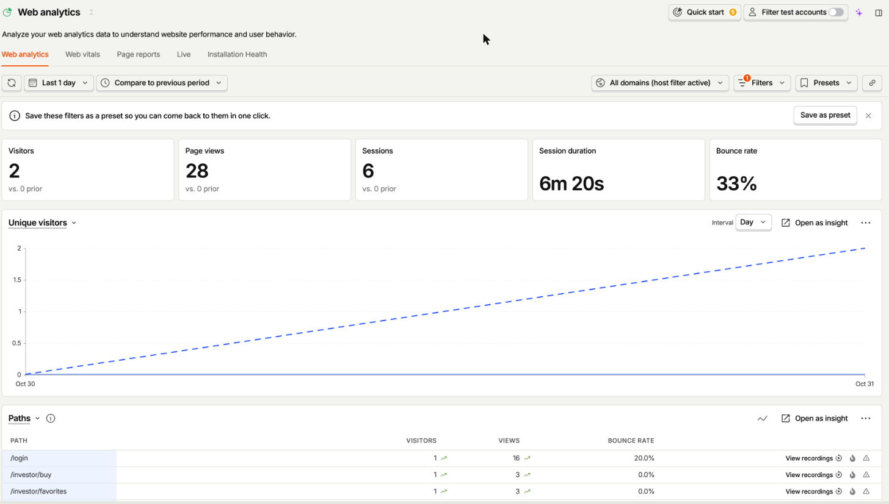

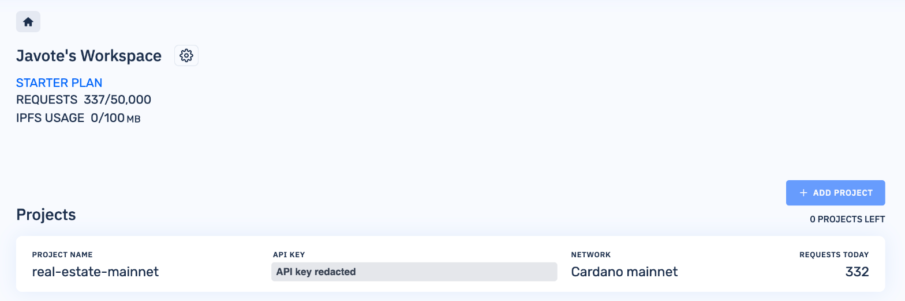

# 6 · Legal greenlight for mainnet

The legal greenlight for operating on mainnet was granted on **October 23, 2026**, before
any mainnet transaction was submitted. Its formal record follows the approval format of the
project's Council of Experts (Whitepaper v1.0): a sign-off that lists the reviewed artifacts — the
URLs, the script hash and addresses above, the reference script and the service wallet — states what
the platform does and does not do, and closes with *APPROVED* and the signature block. It is
submitted alongside this document as **`M4-Sign-off-Legal-Greenlight-Mainnet.pdf`**.

# 7 · Governance playbook

Governance on mainnet follows the two mechanisms of the Whitepaper — off-chain authorization and
on-chain state governance — plus the Council of Experts for approvals, and four operating rules for
what only the operator can do.

## Who approves what

| Decision | Who decides | How it is recorded |
|---|---|---|
| A milestone deliverable (whitepaper, pilot plan, evidence pack) | Council of Experts: Developer 1, Developer 2, Notary | Signed e-mail sign-off in the Council format, archived with the milestone evidence |
| Going live on mainnet | Legal counsel / notary | The legal greenlight sign-off (§6) |
| Changing code that runs on mainnet | Project owner | A commit on `main`; Render only deploys after the CI checks pass |
| Changes to contracts, authorization, migrations, storage or deployment | Project owner, line-by-line review | Same, with review before merge |
| Keys and signing, the service-wallet key, hashing and commitments | Project owner leads; the reviewer must be able to explain every line | Same |
| Moving the platform back from mainnet to Preprod | Project owner | Change of `CARDANO_NETWORK` in the `-mainnet` services, recorded in the runbook |

## Roles and permissions in the code

Every request passes **two checks**: the user's global role, and their membership of the specific
project. The five roles are developer, buyer (investor), certifier, notary and admin (the platform
operator). A buyer's account is bound to their unit; a certifier only sees the stages they were
invited to certify; a notary only signs dossiers that are waiting for them. Every relevant change
writes an append-only audit-log entry with actor, entity, action and time.

On-chain, the stage state machine is the same one the backend enforces —
`Pending → InProgress → {Observed ⇄ InProgress, Completed}` — and the validator only accepts a
transition signed by the admin key, carrying a bounded validity window.

## Custody of the service-wallet key

- **One payment key, no seed phrase**, generated fresh for mainnet and never stored on a
  development machine.
- It lives in the API's environment on Render and **offline in two places** kept by the project
  owner. It is not rotated: the validator is parameterized by its hash.
- The wallet holds only what operations need. Surplus funding is moved out by the owner (as on
  October 31, 2026: see the control below).

## The detection control

A stolen key could anchor false transitions that the validator cannot tell apart. The control is a
**weekly comparison of every transaction of the service wallet against the platform's own record**:
any transaction the platform does not know is an incident until explained.

Run for this document on October 31, 2026:

| | Count |
|---|---|
| Transactions of the service wallet on mainnet (Koios) | 52 |
| Transactions recorded by the platform | 48 — all 48 present in the wallet's history |
| Transactions not recorded by the platform | 4, all explained |

| Transaction | What it is |
|---|---|
| `bfa9f4f1…2a5dd` | Initial funding of the wallet (2 ADA) |
| `e448ec8b…a2863` | Funding of the wallet (446.65 ADA) |
| `3edf75f5…b1ed9` | Publication of the reference script (§1) |
| `ec5678b2…7ed21` | Owner moving the surplus funding out of the service wallet (305.59 ADA) |

# 8 · Operations playbook

## Deploy

1. A change lands on `main`. CI runs lint, type checks, unit tests with 100 % coverage, build, the
   start-up smoke test, dependency audit, static analysis (Semgrep), end-to-end tests and the
   Aiken contract checks.
2. Render deploys the `-mainnet` services **only when CI is green**.
3. The deploy is followed until the service is `live` **on that commit**; a request to `/health`
   wakes the free-tier instance so the deploy is not interrupted.

## Rollback

| What went wrong | How to go back | What it does not undo |
|---|---|---|
| The code | Render → service → Deploys → roll back to the last good deploy (instant) | Anything already written to the database or the chain |
| The data | Turso point-in-time restore into a **new** database, then point the API at it | Transactions already on mainnet |
| The network | Owner switches the `-mainnet` services back to Preprod | Mainnet history: it stays on the public ledger, as intended |

**Nothing on-chain is ever rolled back.** A wrong record is corrected by a new, attributable record —
which is the point of anchoring.

## Incident response on mainnet

| Symptom | Likely cause | Response |
|---|---|---|
| An anchor stays `Pending` or ends `Failed` | Provider timeout, cold start mid-submission | The record is kept; reconciliation on read and the daily job settle it; a failed anchor is retried from the platform without duplicating it |
| Anchoring fails for lack of funds | Service wallet below the operating balance | Fund the wallet from the owner's wallet; the anchor stays recorded as `Failed` and is retried once funded |
| A wallet transaction the platform does not know (detection control) | Owner operation, or a compromised key | Identify it. If not the owner: stop the API, take the key out of Render, inform the pilot participants, and record the incident; existing threads stay verifiable |
| First request takes about a minute | Free-tier instance asleep after 15 minutes | Expected. Warm it up before a demo or a review |
| Errors in Sentry or 5xx in Grafana | A defect | Triage from the trace; fix forward on `main`, or roll back the code |
| Evidence storage near its quota | Large files | R2 free tier: 10 GB per account; the pilot used 115.7 MB |

The full deploy, rollback and incident runbook of the platform (Milestone 3) and the mainnet
cutover runbook are in the repository; Evidence 3 summarizes them.

# Annex A · Mainnet transaction list

Every transaction of the pilot, in the order it was recorded. Each ID links to Cardanoscan; the same
list, with the commitment of each event, is in the repository as
`specs/evidencia-m4-fuentes/2-mainnet/mainnet-txids.csv`.

<!-- include: _gen/txids.html -->
