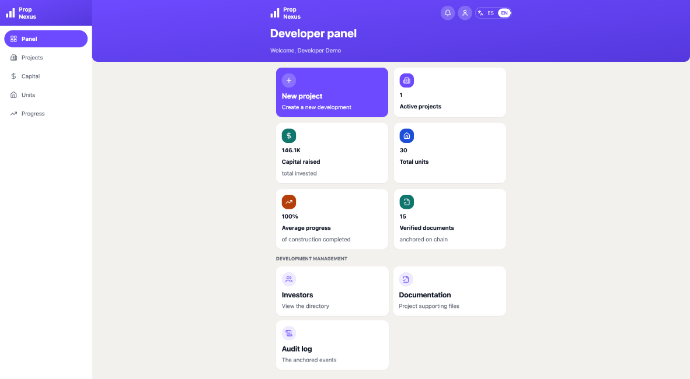
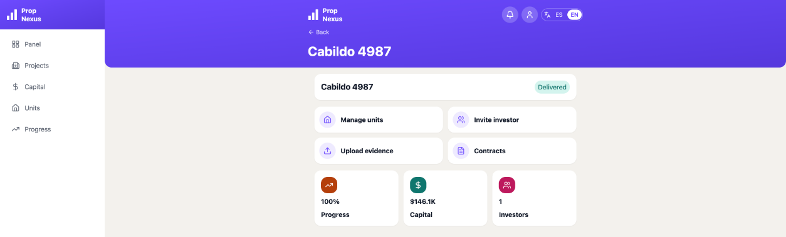
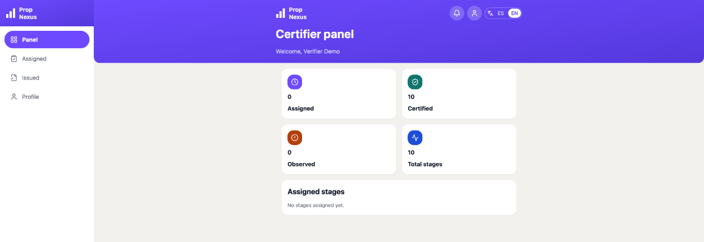
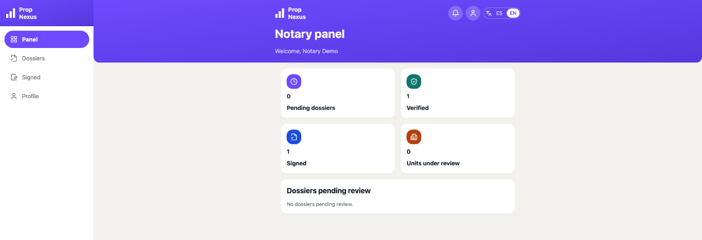
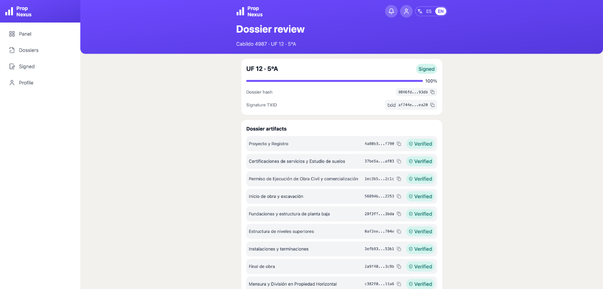
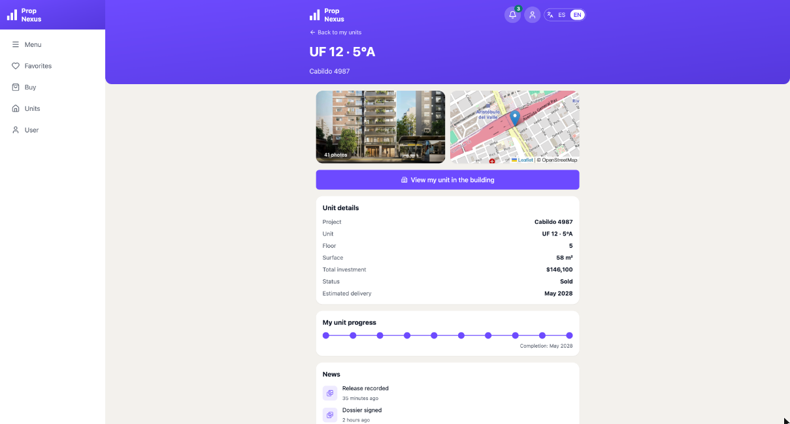
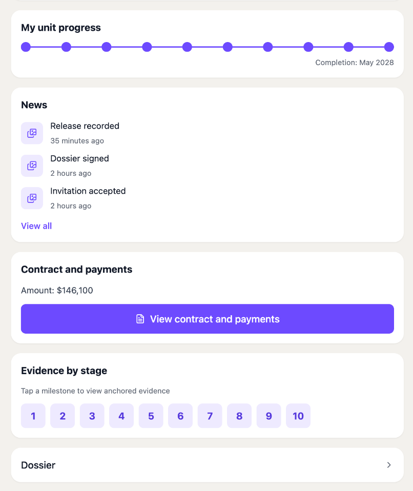
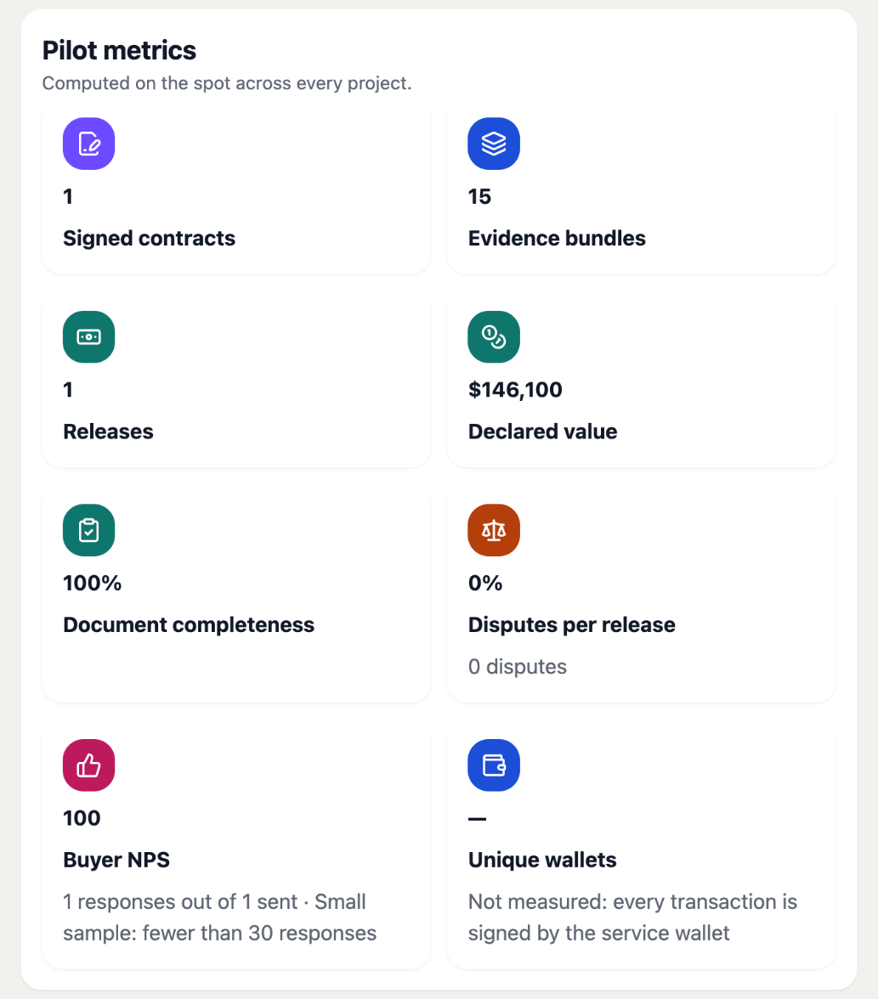

# Updated Documentation Package

This document is the evidence for **Output 3** of Milestone 4: *"Documentation update incorporating
pilot feedback (Whitepaper v1.1, API, user guides) and a notary-verified dossier for at least one
unit."* As Evidence 3 asks, it contains the updated documentation package — Whitepaper v1.1, user
manual, API and runbooks — and the dossier of one unit, with its evidence index, hashes and
signatures.

| Part | Contents | Milestone 4 |
|---|---|---|
| A | **Whitepaper v1.1** — the v1.0 whitepaper revised with what was built and what the pilot showed | Output 3, Evidence 3 |
| B | **User manual** — one section per role, with screens of the mainnet deployment | Output 3 (user guides), Evidence 3 |
| C | **API** — how to authenticate, the 101 operations by area, and the proof object | Output 3, Evidence 3 |
| D | **Runbooks** — deploy, rollback, incident response, mainnet cutover | Evidence 3 |
| E | **Notary-verified dossier** of unit UF 12 · 5°A — evidence index, hashes and signatures | Output 3, Criterion 3, Evidence 3 |

> **Pilot feedback incorporated.** The participants reported that the platform works well, is
> satisfactory, and meets their requirements. The changes in v1.1 therefore do not redesign the
> workflow: they align the documentation with what was built and verified on mainnet, and make
> explicit the boundaries the pilot relied on — what a release is, what anchoring proves, and what
> the platform never does.

# A · Whitepaper v1.1

## What changed from v1.0

| Topic | v1.0 | v1.1 |
|---|---|---|
| Name of a construction step | *Milestone* | **Stage** — to keep it apart from the funding milestones of the project. A stage is what v1.0 called a milestone |
| Final state | *Certified* | **Completed** — still shown to buyers as *certified* |
| Roles | Developer, buyer/investor, admin (certifier and notary mentioned) | Five roles with their own screens and permissions: **developer, buyer, certifier, notary, admin** |
| Smart contract | A state machine (no version stated) | One **Aiken** validator compiled to **Plutus V3**, one on-chain thread per stage, admin-signed transitions with a bounded validity window |
| Authority-first evidence | Required before upload | Implemented as a **declaration**: authoritative evidence must name its issuing authority, or it is rejected; the platform records the declaration and does not verify it |
| "Release" | Not defined | A **record of a payment made outside the platform**, hashed and anchored. The platform never holds or moves funds; the escrow is simulated |
| What the platform asserts | Integrity, time ordering, auditability | The same, stated as **four statements** and nothing more (§ *What anchoring proves*) |
| Pilot | A plan | **Results** of the pilot on Cardano mainnet |
| Risk checklist | Risks and planned controls | The control **as built** and its **verification in the pilot** |
| Deployment | — | **Live on Cardano mainnet** since October 31, 2026 |

## Abstract

Pre-construction real estate sales require buyers to commit capital long before a unit exists as a
registrable asset. Between the first commitment and the final deed, a project accumulates years of
progress records, technical certifications, permits and supporting documents, often spread across
informal channels.

The platform turns that journey into an ordered, auditable history for each unit. It structures the
construction lifecycle into **stages**, collects the evidence of each stage, and anchors
cryptographic fingerprints of that evidence on Cardano with timestamps. Documents and personal data
stay off-chain; the chain holds only fingerprints, opaque references and stage states. A
smart-contract state machine governs how each stage progresses, including the exception path for
failed inspections. Since October 31, 2026 the platform runs on Cardano mainnet, where its first
real project has been recorded end to end.

## Problem and motivation

Buyers cannot reliably verify construction progress, or check that what is shown today is what
existed yesterday. Ambiguity about *completion* leads to disputes that grow more costly as delivery
and deed approach; evidence is inconsistent across projects and professionals; and approvals are
neither time-bound nor transparently tracked.

The purpose is to move from **belief to verification**: buyers follow structured progress for their
unit and can verify the integrity of the documents they are shown; developers build transparency
methodically instead of compensating after a conflict. The platform does not replace public
authorities or legal processes. It makes the evidence trail coherent, time-ordered and
tamper-evident.

## Objectives, and where they stand

| Objective (v1.0) | Status in v1.1 |
|---|---|
| A clear end-to-end workflow for traceability across construction and pre-registration stages | Built and in production: 10-stage default catalog, five roles, on-chain state per stage |
| An evidence model that explains what exists per stage, what it supports and how to verify it | Built: evidence bundles with Merkle commitments, proof objects, public verification steps (below) |
| Integrity proofs on Cardano, with documents and sensitive data off-chain | On mainnet: 48 transactions for the pilot, no personal data on-chain |
| Validation through a pilot with real stakeholders and real data | Done on mainnet with one real project (see *Pilot results*) |

## System overview

**Components.**

- **Web application** — one surface per role: dashboards, unit timelines, evidence, dossiers.
- **Off-chain services and API** — evidence intake and hashing, Merkle commitments, proof objects,
  access control, audit log, and the anchoring pipeline with confirmation and retry.
- **Cardano anchoring layer** — a Plutus V3 validator written in Aiken. Each stage of a project is an
  on-chain *thread*: a unique token, minted when the stage is created, that carries the stage's
  state in its datum and moves with each transition. Evidence bundles are anchored as transaction
  metadata.

**Core entities.** Project and its stages; unit for sale, bound to its buyer; contract; evidence
item and evidence bundle; on-chain event (every transaction, with its network and status); release
record; unit dossier; dispute; audit log.

## Stakeholders, roles and governance

| Role | What it does |
|---|---|
| **Developer** | Creates projects and units, uploads the evidence of each stage, invites buyers and certifiers, records contracts and payment releases |
| **Buyer** | Follows their unit's timeline, sees the evidence of each stage and its proofs, their contract and releases, and their dossier |
| **Certifier** | Reviews the evidence of the stages they were invited to, and certifies (completes) or observes each one |
| **Notary** | Reviews unit dossiers and signs or rejects them |
| **Admin** | The platform operator: onboarding, pilot metrics, operations |

Governance works through two mechanisms. **Off-chain authorization:** every request is checked
against the user's role *and* their membership of the project; a buyer is bound to their unit.
**On-chain state governance:** the validator only accepts the transitions of the state machine,
signed by the platform's admin key and within a bounded validity window. Every relevant change is
written to an append-only audit log with actor, action and time. Approvals of the project's
deliverables go through the **Council of Experts** (below).

## Identity and signatures

Accounts are provisioned through controlled onboarding; each buyer account is bound to a unit, and
professional roles act through identity-bound accounts with scoped permissions.

**Authority-first evidence.** Evidence that must come from a competent authority — permits,
approvals, inspection certificates, notarial instruments — is uploaded as **authoritative** and
must declare its **issuing authority**. Authoritative evidence without an issuing authority is
rejected on upload and on edit, and blocks the completion of its stage. The platform records the
declaration; it does not validate the authority's decision. Non-authoritative evidence (site
photographs, progress logs) can be uploaded freely and is labelled as such.

**Certification and signatures.** Every stage is validation-critical: it cannot be completed without
its evidence. Completion is performed by the certifier. The notary's review of a unit is recorded by
signing its dossier, and that signature is anchored on-chain. Non-repudiation rests on
identity-bound accounts, least-privilege roles, on-chain anchoring of fingerprints and state
transitions, and the audit log.

## Workflow and state model

1. **Setup** — the developer creates the project; its stages are opened on-chain, one thread each.
2. **Evidence** — as work progresses, documents are uploaded to their stage, hashed (SHA-256) and
   grouped into a bundle whose Merkle root is anchored.
3. **Certification** — the certifier completes the stage, or observes it when something must be
   fixed.
4. **Visibility** — each buyer sees a timeline of their unit with the state and evidence of every
   stage.
5. **Commercial record** — contracts, payment releases and the unit dossier are recorded and
   anchored as they happen.

| State | Meaning |
|---|---|
| **Pending** | Defined, not started |
| **In Progress** | Work and evidence under way |
| **Observed** | Flagged by the certifier: requires remediation, with traceable notes and evidence; returns to *In Progress* |
| **Completed** | Certified, with its evidence root anchored (shown to buyers as *certified*) |

`Pending → In Progress → {Observed ⇄ In Progress, Completed}`. The same state machine is enforced by
the backend and by the on-chain validator: a failed inspection becomes an `Observed` cycle,
recorded and attributed, instead of an informal resolution off the system.

## Evidence model and verification

| Evidence category | Examples | Integrity proof |
|---|---|---|
| Technical plans and drawings | Plans, approved versions | SHA-256 per file; bundle commitment anchored |
| Site progress | Dated photographs, reports | Bundle commitment anchored with timestamp |
| Certifications and reports | Certificates, inspection reports | Authoritative, with issuing authority; anchored |
| Permits and approvals | Municipal permits | Authoritative, with issuing authority; anchored |
| Subdivision and registration | Survey, horizontal-property subdivision | Committed and anchored |

**The bundle commitment.** The Merkle root of a bundle is built from the SHA-256 hashes of its files,
**sorted**; each pair is combined as SHA-256 of the two hashes' bytes concatenated, and an odd node
is carried up unchanged. Anyone can recompute it from the files.

**Verification blueprint** — a reviewer does not need to trust the operator:

1. Obtain the file through the authorized access path.
2. Compute its SHA-256 hash.
3. Obtain the proof object of the file (bundle Merkle root, the path to it, the signer, the
   transaction ID and its time), or recompute the root from the bundle's files.
4. Look the transaction up on a public explorer and compare the anchored value. **Match:** the file
   is identical to what was recorded. **Mismatch:** it is not the same artifact.

**What anchoring proves — and nothing more.** The platform supports exactly four statements:
*this file has this hash* · *it was registered at this time* · *it declares to come from this
external authority* · *this person attested to having reviewed it*. It does not certify the
construction, the quality of the work, the legal status of a unit or title over it.

## On-chain and off-chain boundaries

**On-chain:** the state of each stage, in the datum of its thread token (opaque project and stage
references, order, state, evidence root, completion time); and, in transaction metadata under label
**1904**, the commitment of each anchored record (`h`) and an opaque reference to it (`r`). Metadata
strings are at most 64 bytes.

**Off-chain:** the documents and media, identities and contact data, access rules, sharing and the
audit log.

No names, e-mail addresses, file names or internal URLs are ever written on-chain. The pilot's 48
transactions were checked: their metadata carry only hashes and opaque identifiers.

## Releases and the simulated escrow

The *Release* of the project's name is the release of each stage's payment as the work advances. In
the platform a release is **a record that a payment agreed in the contract took place outside the
platform**: its amount and stage are hashed and anchored, the buyer sees it with its transaction,
and the first one triggers the buyer's satisfaction survey. **No validator holds, transfers or
releases funds**; the only ADA locked on-chain is the protocol minimum (2 ADA) that accompanies
each stage's thread token, paid by the platform. The escrow is simulated: the platform reports the
value under contract and how much of it has been recorded as released.

## Privacy and data handling

Data minimization is the default. Identity validation (KYC/KYB) is not the platform's role. Access is
role-based and unit-specific, with least privilege for professionals and operators. Public on-chain
data is limited to fingerprints, opaque references and stage states. Any personal documents a
workflow needs stay off-chain in controlled storage, under access, retention and deletion policies,
and every access and share is logged.

## Legal and registral scope

The platform is an evidence-coordination and integrity layer. It is not a legal authority and
confers no legal status. It does not replace public registries, notarial processes and deed
formalities, permitting and inspection authorities, or legal advice. Within these boundaries it
improves evidentiary organization, integrity and chronological traceability, so that legal counsel,
notaries and registry-facing professionals can review a unit's record with confidence.

## Pilot results

The pilot was run on **Cardano mainnet** on October 31, 2026, with a real project of **Grupo Eagle
Construcciones S.A.** — **Cabildo 4987** (Av. Cabildo 4987, Núñez, Buenos Aires; 30 units; 10
stages) — and one account per role.

- The 10 stages were opened, advanced and certified on-chain; 63 real documents were fingerprinted
  and anchored in 15 bundles; document completeness is 100 %.
- Unit UF 12 · 5°A was sold under a signed contract (USD 146,100); its dossier was signed by the
  notary; the full amount was recorded as released; the buyer's NPS response was 9.
- Independent checks: 48 of 48 transactions found on mainnet; 15 of 15 bundle roots recomputed; 63 of
  63 stored documents re-hash to their anchored fingerprints; the notary's signature verifies
  against the dossier's master hash.
- No incidents. Three display and export defects were fixed the same day, with no data impact.
- Participants' feedback: the platform works well, is satisfactory, and meets their requirements.
- Every stage was certified on its first review; the `Observed` remediation cycle, in production,
  was exercised on 30 stages in the Milestone 3 volume test.

The full pilot report is Evidence 1 of Milestone 4.

## Risk checklist, after the pilot

Risk score = likelihood × impact (1–5 each), as in v1.0.

| ID | Risk | Score | Control as built | Verified in the pilot |
|---|---|---|---|---|
| LR01 | Anchoring mistaken for registral or title effect | 12 | The four statements, stated wherever a proof is shown | The signed dossier and its export state it |
| LR02 | A unit package not reviewable by third parties | 12 | Unit dossier with every artifact, hash and transaction | The notary reviewed and signed one |
| LR03 | Ambiguous versions of the same artifact | 8 | Bundles are cumulative per stage; every version keeps its hash | 15 bundles across 10 stages, each anchored |
| PC01 | Personal data on-chain | 10 | Only hashes and opaque references; 64-byte metadata | 48 transactions checked |
| PC02 | Misconfigured access exposes evidence | 15 | Role check plus project membership on every request; buyer bound to their unit | One account per role, each scoped |
| PC03 | Evidence kept longer than needed | 12 | Data minimization; storage under controlled policies | — |
| DI01 | Hash mismatch after file transformation | 16 | The stored bytes are re-read and hashed after upload | 63 of 63 files re-hash to the anchored value |
| DI02 | Anchors not independently verifiable | 12 | Deterministic fingerprint → bundle → transaction mapping; proof objects | 15 of 15 roots recomputed; 48 of 48 TXIDs on a public explorer |
| DI03 | Evidence without reliable attribution | 12 | Identity-bound accounts, audit log, issuing-authority declaration | Every action attributed to its account |
| PO01 | Partners do not follow the workflow | 12 | Explicit stages and required evidence per stage | 10 of 10 stages completed with evidence |
| PO02 | Onboarding mistakes | 12 | Deliberate role and unit binding by invitation | Buyer and certifier joined by invitation |
| DEP01 | Configuration or secret errors in deployment | 10 | Separate mainnet services; mainnet impossible in local and CI; addresses derived from the blueprint | Addresses re-derived and matched |

## Council of Experts

The Council of Experts is the project's review and approval body. Its core signatories are
**Developer 1, Developer 2 and the Notary**; for each stage gate, the team sends a versioned review
pack and each signatory replies with a signed e-mail sign-off — subject, reviewed artifacts, public
locations and TXIDs, *APPROVED*, and signature block — archived with the milestone evidence. For
Milestone 4, the legal greenlight for mainnet and the notary's attestation on data integrity follow
this format.

## Mainnet references

| | |
|---|---|
| Web application | https://propnexus-web-mainnet.onrender.com |
| Script hash / policy ID | `6207ff3c19443974ee81fbf92419f20b3f45a259ea8808fe4227e6ad` |
| Script address | `addr1w93q0leur9zrja8ws8aljfqe7g9n73dzt84gsz87ggn7dtg3axnw0` |
| Service wallet | `addr1vytx9747v5eq4xn740r6uy00mk3q9uk855smup9g23hun6qhk5qxw` |
| Source code | https://github.com/Javote/real-world-real-estate |

# B · User manual

## Getting started

1. Open **https://propnexus-web-mainnet.onrender.com**. The first visit after a quiet period may take
   about a minute while the server wakes up.
2. Sign in with the e-mail and password of the account you were given. Each account has one role,
   and the app opens on that role's panel.
3. Switch the language between Spanish and English with the **ES / EN** control in the header. The
   bell shows your notifications; the person icon, your profile.

Every hash and transaction ID in the app can be copied with one click, and every transaction ID
opens on Cardanoscan.

## Developer



- **Create a project** from *New project*: name, address, units and delivery date. Its stages are
  opened on-chain; creation takes about 20 seconds while that happens.
- **Manage units** — reference, floor, surface, price and status of each unit.
- **Upload evidence** to a stage: PDF, JPEG or PNG, up to 10 files and 200 MB per file per upload.
  The type is checked from the file's content. Mark official documents as *authoritative* and name
  their issuing authority. Each upload becomes a bundle whose fingerprint is anchored; a file that
  fails validation is rejected on its own and the rest go through.
- **Invite** a buyer to a unit, and a certifier to the project.
- **Contracts** — see the contracts of the project and their anchoring.
- **Audit log** — every anchored event of your projects.



## Certifier



- Accept the developer's invitation to a project; its stages enter your queue.
- Open a stage to review its evidence. **Certify** completes it — the transition is anchored with the
  root of the evidence bundle. **Observe** sends it back for remediation with a note.

## Notary



- **Dossiers** lists the units waiting for your review. A dossier gathers every stage and document
  of the unit, with its hash and transaction.
- Review it and **sign** or **reject** it. A signature is anchored on-chain and fixes the dossier's
  master hash; a rejection carries a note.
- **Signed** keeps the history of your signatures with their transactions.



## Buyer



- **Units** shows the units you bought or were invited to; open one to follow it.
- **My unit progress** shows the ten stages; **Evidence by stage** opens the anchored documents of
  each stage, with their proof.
- **Contract and payments** shows your contract and every release recorded, with its transaction.
- **Dossier** shows the unit's dossier; you can export it as PDF or share it through a link.
- After the first release you receive a one-question satisfaction survey.



## Admin

The admin panel gives the pilot metrics on demand — contracts, bundles, releases, declared value,
document completeness, disputes, buyer NPS — and the members and invitations of each project.



## Verifying a proof yourself

You need the file and its transaction ID.

```
shasum -a 256 <file>                     # the file's SHA-256 fingerprint

curl -s -X POST https://api.koios.rest/api/v1/tx_metadata \
  -H 'content-type: application/json' \
  -d '{"_tx_hashes":["<transaction id>"]}'   # the value anchored under label 1904
```

If the transaction anchors a single file, `h` is its fingerprint. If it anchors a bundle, `h` is the
bundle's Merkle root: recompute it from the fingerprints of all its files (sorted; each pair hashed
as SHA-256 of their bytes concatenated; an odd one carried up), or ask the API for the file's proof
object. Equal values mean the file is exactly what was recorded.


# C · API

| | |
|---|---|
| Base URL (mainnet) | `https://propnexus-api-mainnet.onrender.com/api/v1` |
| Specification | OpenAPI 3.1, generated from the mounted router: `apps/api/api-docs/propnexus.openapi.json` |
| Collection | Postman: `apps/api/api-docs/propnexus.postman_collection.json` |
| Freshness | CI fails if either file differs from the code |
| Authentication | `POST /auth/login` with e-mail and password returns a token; send it as `Authorization: Bearer <token>`. Sessions last 7 days |
| Validation | Every request body is validated against a shared schema before it reaches a handler |
| Errors | JSON with a stable machine-readable code and an HTTP status; messages are translation keys, never user copy |

**101 operations**, by area:

| Area | Operations | What it covers |
|---|---|---|
| `developer` | 22 | Projects, units, evidence upload, invitations, contracts, releases, capital |
| `projects` | 15 | Project detail, stages, members, certifier invitations, anchoring retry |
| `investor` | 15 | Units, contract, releases, dossier, favorites, invitations, survey |
| `certifier` | 9 | Invitations, queue, certify and observe |
| `evidence` | 8 | Files, download, proof object, anchoring, reconciliation |
| `notary` | 6 | Dossier queue, review, sign, reject, signatures |
| `users`, `profile`, `notifications` | 10 | Accounts and preferences |
| `stages`, `disputes`, `admin`, `audit-logs` | 11 | State changes, disputes, pilot metrics, audit log |
| `auth`, `public`, `contracts` | 5 | Login, session, public dossier and cover, releases of a contract |

**The proof object.** `GET /evidence/{bundleId}/proof/{fileHash}` returns, for one file of a bundle:
the bundle's Merkle root, the file's leaf, the Merkle path from the leaf to the root, the account
that signed the upload, the anchoring transaction ID and its time — everything step 3 of the
verification blueprint needs.

**Rejecting unattributed evidence.** Authoritative evidence without an issuing authority is rejected
with `400 EVIDENCE_UNATTRIBUTED` on upload and edit, and stage completion returns `409` while such
evidence is pending.

# D · Runbooks

| Runbook | Where | What it covers |
|---|---|---|
| Deploy, rollback and incident response | `specs/RUNBOOK-deploy.md`; English edition `specs/evidencia-m3/5-ops/runbook.pdf` | First-time setup, everyday deploy, rollback of code and data, incident table, accepted limitations |
| Mainnet cutover | `specs/RUNBOOK-mainnet-cutover.md` | Enabling the network, publishing the reference script, real anchoring on mainnet, publishing addresses |
| Mainnet operations and governance | Evidence 2 of Milestone 4, §7–§8 | Who approves what, key custody, the weekly detection control, mainnet incident response |

The procedures that matter most on mainnet:

- **Deploy only through CI.** Render deploys the `-mainnet` services only when every check passes;
  the deploy is followed until the service is live on that commit.
- **Roll back code, never the chain.** Code rolls back from Render; data, by point-in-time restore
  into a new database. On-chain records are never undone — a wrong record is corrected by a new one.
- **Detect, weekly.** Compare the service wallet's transactions on a public explorer with the
  platform's record; anything the platform does not know is an incident until explained.
- **Key compromise.** Stop the API, remove the key from the service, inform the participants,
  record the incident; existing threads remain verifiable.
- **Wallet without balance.** Fund it from the owner's wallet; failed anchors are retried without
  duplication.

# E · Notary-verified dossier: unit UF 12 · 5°A

| | |
|---|---|
| Developer | Grupo Eagle Construcciones S.A. |
| Project | Cabildo 4987 — Av. Cabildo 4987, Núñez, Buenos Aires |
| Unit | UF 12 · 5°A |
| Dossier | `bitobzet1jkm3hzj39ufqx0j` |
| Status | **Signed** by the notary |
| Signed at | October 31, 2026, 20:22:11 UTC |
| Master hash | `9846fd9b112416a1fb6cd5b4119e385198006685b659ce799f214016a0f393db` |
| Signature transaction | [`af744e52c9ef141e61fd8c6da9609cf6f51f57e026bc06bfe7d778f1b376ea20`](https://cardanoscan.io/transaction/af744e52c9ef141e61fd8c6da9609cf6f51f57e026bc06bfe7d778f1b376ea20) |
| Signature commitment on-chain | `4ed365035fa4d72de952e913a6b39888c319ceed2db080ffb19000025e9c8bfb` |
| Completeness | 100 % — 73 of 73 artifacts anchored |

**The chain of signatures and hashes, verified.**

1. **Documents → fingerprints.** The 63 stored documents were downloaded and hashed again: 63 of 63
   match the SHA-256 listed below.
2. **Fingerprints → bundles → chain.** The 15 bundle Merkle roots recomputed from those fingerprints
   equal the roots anchored on-chain.
3. **Artifacts → master hash.** The master hash recomputed from the 73 artifacts below — in this
   order, each with its kind, reference, hash and transaction — is exactly `9846fd9b…93db`.
4. **Master hash → signature.** SHA-256 of the dossier ID, the master hash and the signing time is
   exactly the commitment in the signature transaction's metadata.

The dossier records **that these hashes were registered at these times, and that the notary
attested to reviewing them**. It certifies nothing about the construction itself. The payment
release recorded after the signature (21:33 UTC) is outside what was signed.

## Evidence index

For stages, the hash is the root of the stage's evidence bundle and the transaction is the one that
completed the stage. For documents, the hash is the file's SHA-256 and the transaction is the one
that anchored its bundle. Document names are as uploaded by the developer.

<!-- include: _gen/dossier.html -->
